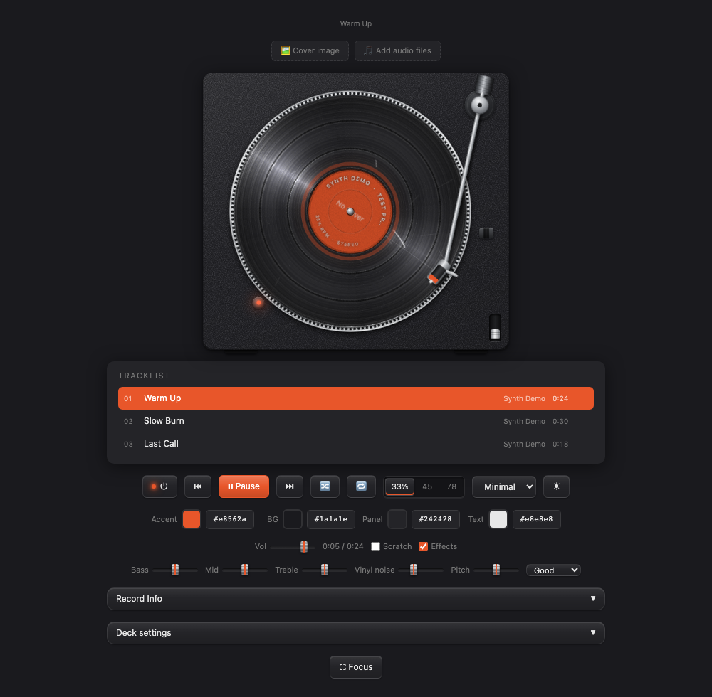
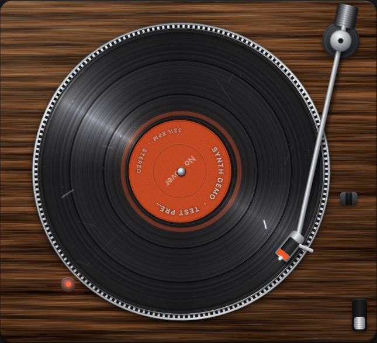
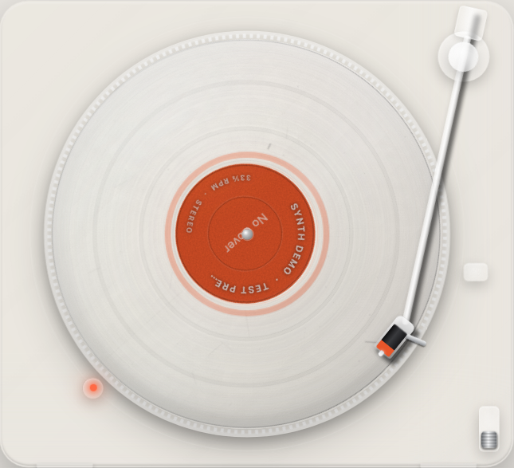

# Realistic Vinyl Player

A turntable in one HTML file. It plays your own audio files and tries to look, move and sound like a real deck: the platter spins up and coasts down, the tonearm tracks across the whole record, and the pitch follows the platter speed.

**[Try it in your browser](https://gitguy268.github.io/realistic-vinyl-player/?demo)** (the link loads three short demo tracks).

Remake of [Gitguy268/Vinyl-Player](https://github.com/Gitguy268/Vinyl-Player). Same layout, controls, themes and saved data; new materials, physics and audio engine.



| Wood | Clear |
|---|---|
|  |  |

## Run it

Open `index.html` in a browser. That is all: no build step, no dependencies, no network requests. It works offline and from `file://`.

Add `?demo` to the URL to load three short synthesized tracks, so you can try it without any files. Demo tracks are kept in memory and never touch your saved library.

To preview it the way the website serves it, run this in the repository folder and open <http://localhost:8000/>:

```
python3 -m http.server 8000
```

## What is realistic

**Motion**

- Platter speed is exact: 33⅓ rpm is 200°/s, 45 is 270°/s, 78 is 468°/s. The motor takes about 1.4 s to reach speed and the platter coasts for about 3 s.
- The tonearm is a pivoted arm. Its angle comes from the pivot geometry (law of cosines), so the stylus traces the arc a real arm would.
- The record holds the whole playlist. Tracks are groove bands sized by their duration, with gaps between them, a lead-in at the edge and a run-out with a locked groove near the label.
- Play starts the motor and lowers the stylus with a damped cue and a small landing bounce. Pause lifts it. Track changes lift, swing and lower in under a second.
- Drag the tonearm and drop it on a groove to play from there. Drop it on a gap for the next track's start, or off the record to park it.
- Put a hand on the record to scrub. On release it slips against the mat and catches the platter in about a quarter of a second.
- At the end of the record the stylus runs into the locked groove, thumps once per turn, then the arm returns.
- Optional: record sides. The playlist is cut into sides of about 22 minutes, only the side that is up is on the record, and you flip it to continue.
- Optional: record size follows speed. A 12-inch LP at 33⅓, a 7-inch single on an adapter at 45, a 10-inch shellac at 78.

**Sound**

- Pitch follows platter speed everywhere: spin-up, spin-down, the 45 and 78 settings, the ±8% pitch fader, and wow and flutter.
- Scratch mode plays the real track under your hand, forwards and backwards.
- After the EQ the signal gets what a cut record gives it: mono bass below 120 Hz, −25 dB channel crosstalk, a high-frequency roll-off (lower at 78 and towards the inner grooves) and a little soft saturation.
- Surface noise is generated, not looped: hiss, randomly timed crackle, rare pops and faint motor rumble. Each record has its own scratches, which tick once per turn at the place where they are drawn.
- Cue lever, arm, needle drop, motor, speed switch and record placement all have synthesized sounds.

**Look**

- Machined platter with strobe marks that stand still at the right speed and drift when the pitch is off.
- Record face drawn once per change: rim, lead-in, grooves shaded by each track's loudness, track gaps, run-out and locked groove.
- Two highlights stay fixed in the room while the record turns under them.
- Plinth per theme: matte (Minimal), walnut veneer (Wood), glass with a translucent record (Clear). All textures are generated; there are no image files.

## Controls

| Control | What it does |
|---|---|
| ⏻ | Motor on or off. With the stylus down, the music winds up or down with the platter. |
| ⏮ ▶ ⏭ | Previous, play or pause, next |
| 🔀 🔁 | Shuffle; repeat off, one, all |
| 33⅓ / 45 / 78 | Platter speed |
| Theme, ☀ | Minimal, Wood or Clear; light or dark |
| Accent, BG, Panel, Text | Custom colours (these override the light/dark toggle) |
| Vol, Bass, Mid, Treble | Volume and three-band EQ |
| Scratch | Hear the record while you turn it by hand |
| Effects | Mechanical sounds on or off |
| Vinyl noise | Level of everything the record surface adds |
| Pitch | ±8%. Double-click to reset. |
| Condition | Mint, Good, Worn or Beat-up: hiss, crackle, scratches, dust and treble loss |
| Cue lever, tonearm click | Lift or lower the stylus; the motor keeps running |
| Record Info | Tags for the current track and editable liner notes |
| Deck settings | Imperfection (wow, flutter, wobble), keep the platter spinning when paused, auto-return, record sides, record size follows speed |
| Side A ⇄ | Flip the record. Shown beside the tracklist heading when "Record sides" is on and the playlist needs more than one side. Choosing a track on another side flips it for you. |
| Focus | Larger deck with a floating control bar |
| Media keys | Play, pause, previous, next and seek from the keyboard's media keys or a headset |

Drag audio files or a cover image onto the page to add them.

### Keyboard

| Key | Action |
|---|---|
| Space | Play or pause |
| ← / → | Back or forward 5 s. ← near the start of a track goes to the previous track. |
| ↑ / ↓ | Volume |
| S | Shuffle |
| R | Repeat |
| F | Focus mode |
| Esc | Leave focus mode |

## Privacy

Everything stays on your device. Audio files, cover art and notes are stored in your browser's IndexedDB (`vinyl-db`); settings are in `localStorage`. The page makes no network requests.

Your library and settings from the original Vinyl-Player carry over when this page is served from the same address as the original was. New settings are stored under a separate key (`vinyl-deck`), so the original keeps working beside it.

## Limits

- Tracks longer than 20 minutes, and files the browser cannot decode into memory, play through the plain media element. They still follow platter speed and pitch, but they scrub silently, cannot play backwards and do not get wow and flutter. In Safari that path cannot glide: the music starts once the platter is at speed and stops when the motor is switched off.
- A decoded track is held as 16-bit samples: about 0.18 MB of memory per second of stereo audio, and twice that for a moment while it is being decoded. Only the current track and the next one are held.
- Above 33⅓ rpm the sped-up audio is smoothed by a simple averaging filter. Measured: a 20 kHz tone played at 78 folds back 30 dB quieter than without it, and at 45 it costs 0.7 dB at 13.5 kHz.
- Tags and cover art are read from MP3 (ID3 v1, v2.3, v2.4), FLAC and M4A/MP4 files. Other formats play, without tags. Tags are read when a file is added, so tracks saved before this was supported keep their file names.
- The flip is drawn flat (the record turns edge-on and back), without perspective.
- Lock-screen controls depend on the browser: while the audio engine plays a decoded track, some browsers show no media controls.

## Development

There is nothing to build to run it. Two URL switches help with testing:

- `?selftest` checks the arm geometry, the track-to-groove mapping, the side packing and the tag parsers, and logs `selftest ok`.
- `?debug` exposes the deck state as `window.__deck`.

The checks in `test/` drive the page in Chromium, Firefox and WebKit with Playwright. Playwright is a development dependency of the tests only.

```
cd test
npm ci && npx playwright install
npm run lint          # syntax, no outside resources, no debug leftovers, links
npm run build         # assembles the published site in _site/
npm test              # behaviour, in all three browsers
npm run test:audio    # pitch, glide, aliasing and click measurements (prints a report)
ORIGINAL=/path/to/Vinyl-Player/index.html npm run parity   # layout against the original
```

Versions are pinned: Playwright in `test/package.json`, Node and the GitHub Actions in `.github/workflows/`.

All tunable physical constants (record dimensions, spin-up and coast times, wow and flutter amounts, noise levels, arm timings) are in one block at the top of the script in `index.html`.

## Deploy

The site is static. Every push to `main` runs `.github/workflows/pages.yml`, which copies `index.html`, `llms.txt` and `sitemap.xml` into `_site/` and publishes that folder to GitHub Pages. To set it up on a fork: Settings → Pages → Source: GitHub Actions, and keep "Enforce HTTPS" on.

For a custom domain, add a `CNAME` file with the domain to the published folder (copy it in the `build` script in `test/package.json`) and set the domain under Settings → Pages.

## Contributing

Bug reports, ideas and pull requests are welcome. Read [CONTRIBUTING.md](CONTRIBUTING.md) first; it covers how to run the checks and the few rules that keep the player a single offline file. Everyone taking part is expected to follow the [Code of Conduct](CODE_OF_CONDUCT.md). Report security problems privately, as described in [SECURITY.md](SECURITY.md).

## Licence and attributions

Code: [MIT](LICENSE).

- No third-party code, fonts, images, icons or audio are included. Text uses the fonts already on your device, every texture is generated in the page, and the demo tracks are synthesized.
- Screenshots in `screenshots/` show the demo tracks only.
- The [Code of Conduct](CODE_OF_CONDUCT.md) is the [Contributor Covenant 2.1](https://www.contributor-covenant.org/version/2/1/code_of_conduct/), used under [CC BY 4.0](https://creativecommons.org/licenses/by/4.0/).
- The layout, themes and ID3 parser come from the original [Vinyl-Player](https://github.com/Gitguy268/Vinyl-Player) by the same author.
